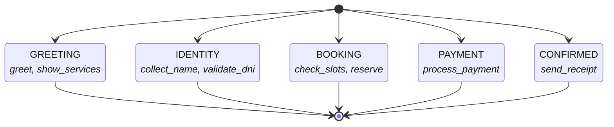

# reactive-fsm

[](https://www.npmjs.com/package/reactive-fsm)
[](https://github.com/roddcode/reactive-fsm/actions/workflows/ci.yml)
[](https://github.com/roddcode/reactive-fsm/blob/main/LICENSE)

**State-scoped tool availability for TypeScript AI agents.** Define which tools are visible at each step of a conversation, with a small, explicit state machine and a per-step tool budget. Zero runtime dependencies.

LLMs call tools in loops, in the wrong order, or before the data exists. reactive-fsm gates which tools are advertised in each state. It is advisory: the application still authorizes and validates execution.

> Migrating from `1.x`? See [`docs/migrations/1.x-to-2.0.0.md`](docs/migrations/1.x-to-2.0.0.md).



> Generated by `fsm.toMermaid()`. Paste into any README, PR, or Notion.

## What it does

- **Tool budget.** Counts consecutive tool calls between steps: configurable threshold, two modes (`consecutive` any-tool or `repeated` same-tool), optional `onLoop` callback. It is an admission budget: multiple calls inside one step can still exceed it.
- **Async guard.** `guard` accepts `Promise<boolean>`. Use `transitionToAsync()` for DB checks or API calls. A transition is rejected if the state changed while the guard was pending.
- **State groups.** `STATE:substate` naming convention. `currentStateGroup` returns `'STATE'` for `'STATE:date'`, `'STATE:time'`, `'STATE:confirm'`.
- **Vercel AI SDK 7 first.** Official adapter with `prepareStep`/`activeTools`. OpenAI, Anthropic, LangChain and Gemini adapters are experimental until they have contract tests.

## Quickstart

```bash
npm install reactive-fsm
```

Requires Node 20+.

```typescript
import { createFSM } from 'reactive-fsm'

const fsm = createFSM({
  initialState: 'IDENTITY',
  states: ['IDENTITY', 'BOOKING', 'PAYMENT'] as const,
  tools: {
    IDENTITY: ['validate_dni'],
    BOOKING: ['check_availability', 'reserve_slot'],
    PAYMENT: ['process_payment'],
  },
  loopShield: { enabled: true, maxConsecutiveTools: 3 },
})

fsm.currentState        // 'IDENTITY'
fsm.allowedTools        // ['validate_dni']

fsm.transitionTo('BOOKING')
fsm.allowedTools        // ['check_availability', 'reserve_slot']
```

### With Vercel AI SDK 7

```typescript
import { generateText, isStepCount, jsonSchema } from 'ai'
import { openai } from '@ai-sdk/openai'
import { createFSM, type ToolEntry } from 'reactive-fsm'
import { createVercelAdapter } from 'reactive-fsm/adapters/vercel-ai'

interface Ctx {
  contactId: string
}

const fsm = createFSM({
  initialState: 'IDENTITY',
  states: ['IDENTITY', 'BOOKING'] as const,
  tools: {
    IDENTITY: ['validate_dni'],
    BOOKING: ['check_availability'],
  },
})

const registry: ToolEntry<Ctx>[] = [
  {
    name: 'validate_dni',
    gates: ['IDENTITY'],
    build: () => ({
      description: 'Validate the customer DNI',
      inputSchema: jsonSchema({
        type: 'object',
        properties: { dni: { type: 'string' } },
        required: ['dni'],
      }),
      execute: async ({ dni }: { dni: string }) => {
        if (!dni) throw new Error('DNI is required')
        fsm.transitionTo('BOOKING')
        return { valid: true }
      },
    }),
  },
  {
    name: 'check_availability',
    gates: ['BOOKING'],
    build: () => ({
      description: 'Check available slots',
      inputSchema: jsonSchema({ type: 'object', properties: {} }),
      execute: async () => ({ slots: ['10:00', '11:00'] }),
    }),
  },
]

const adapter = createVercelAdapter(fsm, registry, { contactId: 'c-1' })

const response = await generateText({
  model: openai('gpt-4o'),
  prompt: 'Hola, quiero reservar una cita',
  ...adapter.inject(), // { tools, prepareStep }
  stopWhen: isStepCount(5),
})
```

`inject().tools` contains the full `ToolSet`; `prepareStep` returns `activeTools` with only the tools allowed by the current FSM state. The adapter does not mutate the tool set.

### With OpenAI (imperative loop)

```typescript
import { createOpenAIAdapter } from 'reactive-fsm/adapters/openai'

const adapter = createOpenAIAdapter(fsm, registry, context)

while (true) {
  const { tools } = adapter.inject()
  const response = await openai.chat.completions.create({
    model: 'gpt-4o', messages, tools,
    tool_choice: adapter.isLooping() ? 'none' : 'auto',
  })
  if (response.choices[0].message.tool_calls?.length) {
    adapter.registerToolCall()
    continue
  }
  return response.choices[0].message.content
}
```

## Real-world use cases

### Booking funnel

```typescript
const booking = createFSM({
  initialState: 'GREETING',
  states: ['GREETING', 'IDENTITY', 'SCHEDULING', 'CONFIRMED'],
  tools: {
    GREETING:    ['greet', 'show_services'],
    IDENTITY:    ['collect_name', 'collect_contact'],
    SCHEDULING:  ['check_slots', 'reserve_appointment'],
    CONFIRMED:   ['send_confirmation', 'add_to_calendar'],
  },
  prompts: {
    SCHEDULING: 'Offer available slots. Do not ask for identity again.',
  },
  loopShield: { enabled: true, maxConsecutiveTools: 3 },
})
```

In `SCHEDULING`, `collect_name` is gone. The LLM cannot loop back asking for data it already has.

### Payment gate

```typescript
const checkout = createFSM({
  initialState: 'BROWSING',
  states: ['BROWSING', 'CART', 'PAYMENT', 'CONFIRMED'],
  tools: {
    BROWSING:  ['search', 'add_to_cart'],
    CART:      ['view_cart', 'apply_coupon', 'checkout'],
    PAYMENT:   ['process_payment', 'cancel_order'],
    CONFIRMED: ['send_receipt'],
  },
  guard: (from, to) => to === 'PAYMENT' && from !== 'CART' ? false : true,
})
```

In `PAYMENT`: 2 tools. The LLM cannot browse, cannot suggest alternatives, cannot negotiate. The guard blocks jumping from BROWSING straight to PAYMENT.

### Customer support with forced escalation

```typescript
const support = createFSM({
  initialState: 'TRIAGE',
  states: ['TRIAGE', 'DIAGNOSIS', 'SOLUTION', 'ESCALATION'],
  tools: {
    TRIAGE:      ['classify_issue', 'verify_account'],
    DIAGNOSIS:   ['search_kb', 'check_status'],
    SOLUTION:    ['apply_fix', 'send_guide'],
    ESCALATION:  ['transfer_to_human'],
  },
  loopShield: { enabled: true, maxConsecutiveTools: 3 },
})
```

The tool budget trips after 3 consecutive tool calls. It does not know whether the tool succeeded or failed; if you need failure-aware escalation, implement it in your tool `execute` and transition explicitly. `ESCALATION` has exactly one tool.

## Adapters

| Provider | Import | Status | Tool budget |
|----------|--------|--------|-------------|
| Vercel AI SDK 7 | `reactive-fsm/adapters/vercel-ai` | Official | Automatic via `prepareStep` |
| OpenAI | `reactive-fsm/adapters/openai` | Experimental | Manual via `isLooping()` |
| Anthropic | `reactive-fsm/adapters/anthropic` | Experimental | Manual via `isLooping()` |
| LangChain | `reactive-fsm/adapters/langchain` | Experimental | Manual via `shouldStop()` |
| Google Gemini | `reactive-fsm/adapters/gemini` | Experimental / legacy SDK | Manual via `isLooping()` |

Only the Vercel AI SDK 7 adapter is covered by contract tests in `1.5.0`. The other adapters format tool definitions; they are not full runtime integrations.

## Scope

reactive-fsm is a small policy layer, not an agent runtime or a full statechart engine.

- It does not execute tools or authorize side effects. The application must validate arguments and enforce permissions.
- It does not persist conversation context; `snapshot()` stores only the current state.
- It does not detect semantic loops. The tool budget counts calls between steps.
- It does not replace LangGraph, Mastra, OpenAI Agents SDK or XState. Use those when you need durable orchestration, a full runtime or a statechart.

## API

```typescript
interface FSMConfig<S extends string = string> {
  initialState: S
  states: readonly S[]
  tools: Partial<Record<S, string[]>>
  loopShield?: {
    enabled: boolean
    maxConsecutiveTools: number
    mode?: 'consecutive' | 'repeated'
    fallbackState?: S
    onLoop?: (info: { consecutiveTools: number; maxAllowed: number }) => void
  }
  onTransition?: (from: S, to: S) => void
  guard?: (from: S, to: S, context: Record<string, unknown>) => boolean | Promise<boolean>
  prompts?: Partial<Record<S, string>>
  snapshot?: { state: S }
  context?: Record<string, unknown>
}

interface FSMPublic<S extends string = string> {
  currentState: S
  currentStateGroup: string       // 'SCHEDULING' for 'SCHEDULING:date'
  allowedTools: string[]
  isLooping: boolean
  transitionTo(state: S): void
  transitionToAsync(state: S): Promise<void>   // for async guard
  snapshot(): { state: S }
  toMermaid(): string
  context: Record<string, unknown>
}
```

Usa `as const` en `states` para conservar la unión literal de estados; sin eso, `S` se widen a `string`.

```typescript
interface ToolEntry<TContext = any> {
  name: string
  gates: string[]
  condition?: (ctx: TContext) => boolean
  build: (ctx: TContext) => unknown  // provider-specific tool shape
  schema?: unknown                   // optional; pass to validateWith() (Zod/Valibot); not automatic
}

buildToolsForGate(gate, ctx, registry): Record<string, unknown>
validateWith(schema, args): { ok, data } | { ok, error }
```

## Architecture

```
src/core/            zero npm dependencies
  machine.ts         createFSM()
  tool-gating.ts     buildToolsForGate(), validateWith()
  loop-shield.ts     createLoopShield()

src/adapters/        provider-specific formatters
  vercel-ai.ts       createVercelAdapter()
  openai.ts          createOpenAIAdapter()
  anthropic.ts       createAnthropicAdapter()
  langchain.ts       wrapWithFSM()
  gemini.ts          createGeminiAdapter()
```

MIT · [GitHub](https://github.com/roddcode/reactive-fsm) · [Issues](https://github.com/roddcode/reactive-fsm/issues)

---

Built by [roddcode](https://roddcode.com): I build AI systems that don't fail when money is at stake. [Hablemos 30 minutos](https://roddcode.com) · [LinkedIn](https://linkedin.com/in/alejandro-alvarado-roddcode)
